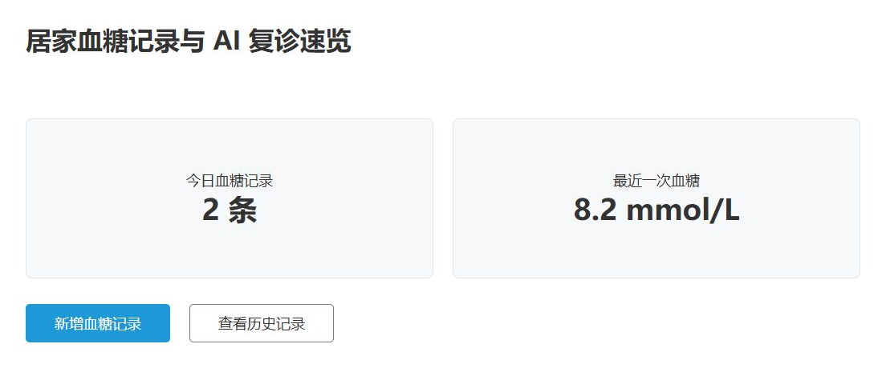
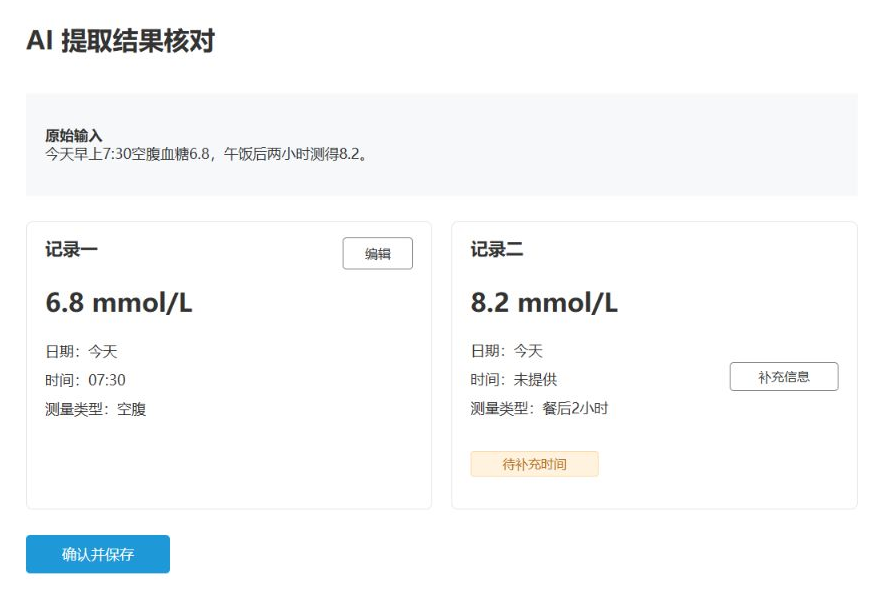
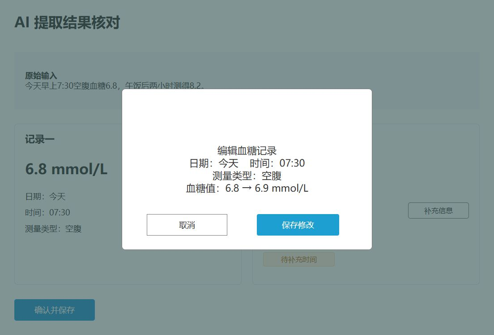
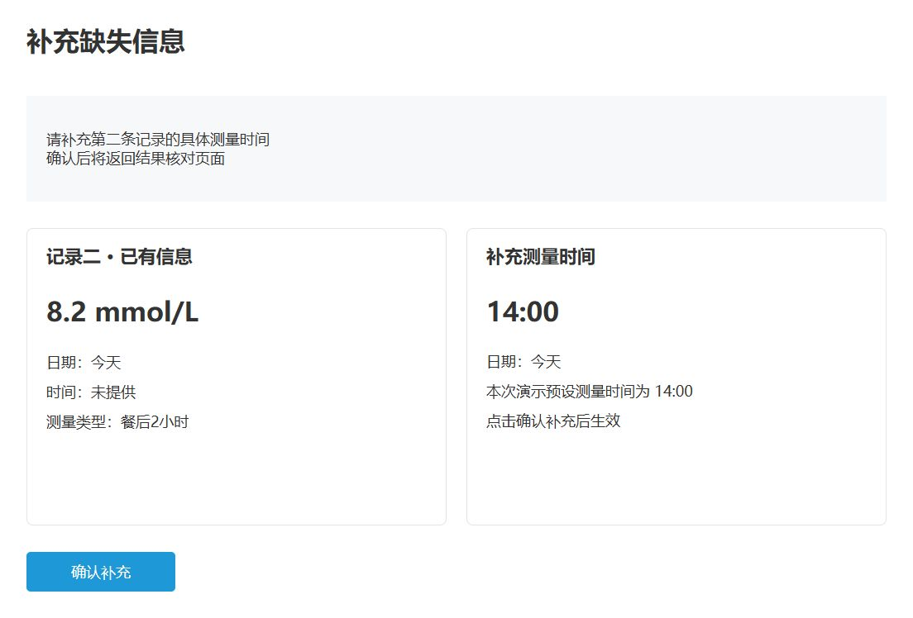
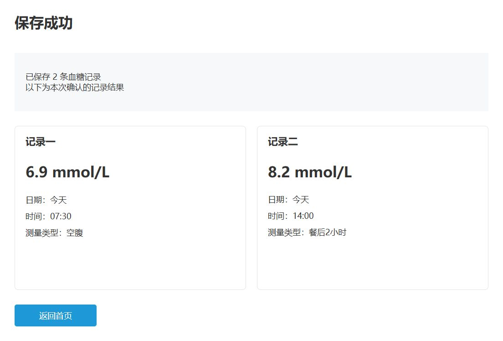

# 居家血糖记录与 AI 复诊速览

围绕居家血糖记录、信息核对和复诊准备的产品设计项目。本仓库集中展示交互原型、配套需求文档、竞品研究及相关产品体验报告。

**[打开在线原型](https://23huabb.github.io/glucose-ai/)**

## 在线原型

使用 Axure RP 11 制作，当前版本为 V2.1。演示流程为：

首页 → AI 文字录入 → 提取结果核对 → 编辑记录 → 补充测量时间 → 确认保存 → 返回首页。

原型使用固定演示数据，重点展示记录核对、缺失信息提示与用户确认交互。PRD 包含更完整的需求范围；当前在线原型覆盖其中的血糖录入与核对流程。

## Axure 原型截图

点击截图查看大图。

**P01 血糖记录首页**

[](docs/screenshots/p01-home.png)

| P05 AI 提取结果核对 | P06 编辑记录 |
| --- | --- |
| [](docs/screenshots/p05-review.png) | [](docs/screenshots/p06-edit.png) |
| **P07 补充信息** | **P08 保存成功** |
| [](docs/screenshots/p07-supplement.png) | [](docs/screenshots/p08-saved.png) |

## Python 数据分析

覆盖 400 名模拟用户、90 天和 17,168 条原始操作记录，清洗后保留 16,887 条。Notebook 展示录入与复诊准备漏斗、分类回访、用户行为分群和失败恢复，并根据模拟结果提出草稿提示、保存重试反馈和历史入口埋点的验证建议。

[查看居家血糖用户行为分析 Notebook](analysis/居家血糖用户行为分析.ipynb)

在仓库根目录使用 Python 3.12 安装依赖并运行。原有配置和固定种子会重建模拟数据、指标及交互式图表。

```bash
python -m pip install -r analysis/requirements.txt
python analysis/run_analysis.py
```

## 项目配套资料

| 资料 | 内容 | 入口 |
| --- | --- | --- |
| 竞品分析报告 V1.2 | 居家血糖管理与 AI 复诊辅助方向的竞品研究、需求分析和产品定位比较 | [阅读 PDF](docs/project/%E7%AB%9E%E5%93%81%E5%88%86%E6%9E%90%E6%8A%A5%E5%91%8A_V1.2.pdf) |
| 产品需求文档 PRD V1.0 | 产品定位、业务流程、详细需求、AI 能力边界与验收要求 | [阅读 PDF](docs/project/%E5%B1%85%E5%AE%B6%E8%A1%80%E7%B3%96%E8%AE%B0%E5%BD%95%E4%B8%8E%20AI%20%E5%A4%8D%E8%AF%8A%E9%80%9F%E8%A7%88_PRD_V1.0.pdf) |

建议先查看在线原型，再按需要阅读竞品分析和 PRD，了解研究依据与设计细节。

## 相关产品体验

[讯飞晓医产品体验报告](docs/related/%E8%AE%AF%E9%A3%9E%E6%99%93%E5%8C%BB%E4%BA%A7%E5%93%81%E4%BD%93%E9%AA%8C%E6%8A%A5%E5%91%8A.pdf)

从医疗 AI 产品体验视角，补充对信息可信度、结果核对和持续健康管理的观察。单独归入相关体验资料，便于与本项目配套文档区分。

## 文件组织

- `docs/project/`：本项目配套的竞品分析报告与 PRD。
- `docs/related/`：讯飞晓医产品体验报告。
- `index.html`、页面 HTML 和 `data/`、`files/`、`images/`、`plugins/`、`resources/`：Axure 导出的完整演示及依赖资源，保持原有相对路径。

直接通过上方链接查看原型和 PDF 即可。
